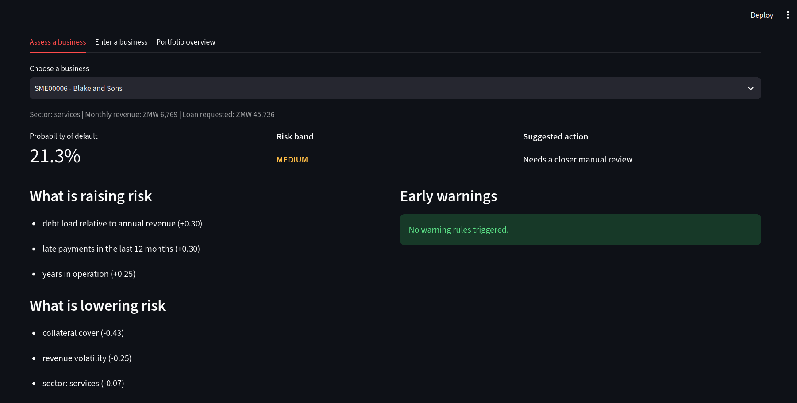
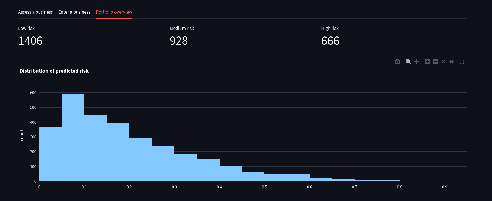
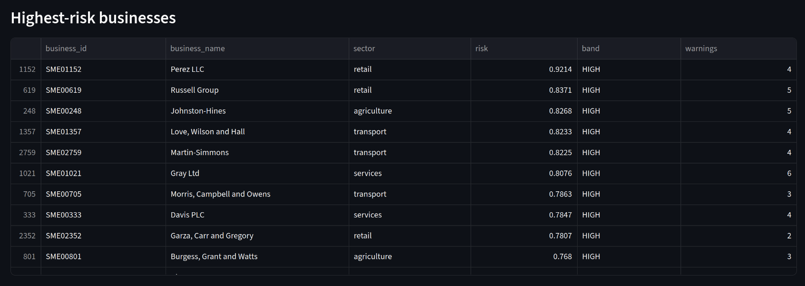

[sme-credit-engine-README.md](https://github.com/user-attachments/files/34199826/sme-credit-engine-README.md)
# SME Credit Risk Engine

A small end-to-end machine learning project: it scores the default risk of small businesses, explains the score in plain language, raises early warnings, and presents everything in an interactive dashboard.

> **Demo only.** All businesses and outcomes are synthetic. The model learns from a simulated risk formula, so its accuracy says nothing about real lending. It must not be used for real credit decisions.




## What it does

- **Generates** 3,000 synthetic SMEs (revenue, expenses, debt, late payments, collateral, cash buffer, sector)
- **Trains** a logistic regression risk model and compares it with gradient boosting
- **Scores** each business with a default probability and a LOW / MEDIUM / HIGH band
- **Explains** each score by showing the factors that raise and lower risk
- **Warns** with transparent rules (low cash runway, falling revenue, repeat late payments, heavy debt, thin collateral, thin margin)
- **Presents** it all in a Streamlit dashboard: assess a business, enter your own, or view the whole portfolio

## Why this project exists

My earlier hardware prototype for the Absa GenAI-Thon (an Arduino vault lock driven by a threshold rule) called a simple rule an "AI agent." This version does the work properly: real data handling, a trained and evaluated model, explanations, tests and honest documentation of its limits.

## How it works

```
generate_data.py -> data/smes.csv -> train_model.py -> models/credit_model.joblib
                                                            |
                            rules.py (warnings) -----> scoring.py -----> app.py (dashboard)
```

```
.
├── app.py                  # Streamlit dashboard
├── src/
│   ├── generate_data.py    # synthetic SME data
│   ├── features.py         # shared feature engineering
│   ├── train_model.py      # training and evaluation
│   ├── thresholds.py       # cut-off trade-off table
│   ├── rules.py            # early-warning rules
│   └── scoring.py          # score + explanation for one business
├── tests/test_rules.py     # unit tests for the warning rules
└── requirements.txt
```

## Results (on synthetic data)

| Model | AUC | Brier score |
|-------|-----|-------------|
| Logistic regression (kept) | 0.748 | 0.140 |
| Gradient boosting | 0.691 | 0.154 |

- **Accuracy is misleading here.** About 80% of businesses do not default, so a model that always says "no default" is also about 80% accurate. I report AUC and the trade-off table below instead.
- **The simple model won.** The synthetic data was generated from a logistic-style formula, so gradient boosting added noise rather than signal on 2,400 training rows.

Risk cut-offs are a business decision. This table (from `src/thresholds.py`) shows the trade-off:

| Cut-off | Businesses flagged | Defaulters caught | Flags that were real |
|---------|--------------------|-------------------|----------------------|
| 0.15 | 54% | 82% | 31% |
| 0.30 | 23% | 50% | 43% |
| 0.50 | 6% | 15% | 55% |

I set LOW below 0.15 and HIGH at 0.30 as a balance between missing defaulters and overwhelming reviewers.

## Model card

- **Intended use:** learning, demonstration and portfolio review. Not for real lending.
- **Data:** fully synthetic. The default label comes from a hand-written risk formula plus random noise, so the model mostly rediscovers that formula.
- **Inputs:** business financial indicators and sector. No personal or demographic attributes are used.
- **Explanations:** per-business contributions (standardised value times coefficient, in log-odds). They describe the model, not real-world cause and effect.
- **Warning rules:** illustrative thresholds. A real lender would set them with credit specialists and validate them on real portfolio data.
- **Human in the loop:** the system suggests an action for a credit officer. It never approves or declines anything.

## Known limitations

- Synthetic data only, with no real SME or mobile-money transaction data
- No calibration step yet (probabilities are model outputs, not validated frequencies)
- Fairness and bias testing needs real data and was not possible here
- Single train/test split with no cross-validation yet

## Run it

```bash
git clone https://github.com/biniboy022xit-cell/sme-credit-engine.git
cd sme-credit-engine
python3 -m venv venv && source venv/bin/activate
pip install -r requirements.txt

mkdir -p data models
python3 src/generate_data.py
python3 src/train_model.py
python3 -m pytest tests -q
streamlit run app.py
```

## Roadmap

- [ ] SHAP explanations and probability calibration
- [ ] Cross-validation and a held-out evaluation report
- [ ] PostgreSQL storage for businesses, transactions and an asset register
- [ ] An LLM "agent" layer that calls the scorer and rules as tools to write plain-English assessments (the model and rules still make the decision)
- [ ] Optional physical output: the Arduino vault from my Absa prototype as a hardware indicator

## Author

**Matibini Handiya**, Computer Science student (Computer Systems Engineering focus), University of Zambia.
GitHub: [biniboy022xit-cell](https://github.com/biniboy022xit-cell)
