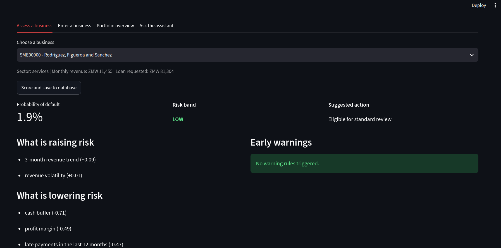
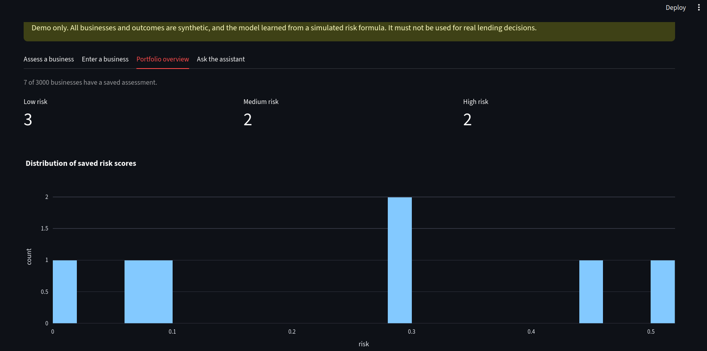
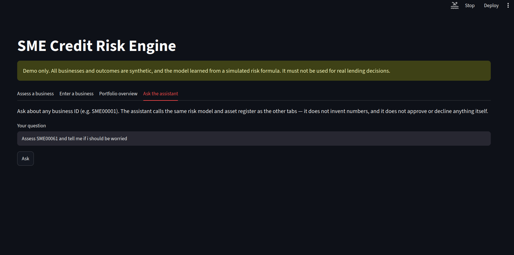

# SME Credit Risk Engine

An end-to-end project: a scoring model, a rules-based warning system, persistent storage, and a tool-using AI agent, all wrapped in an interactive dashboard. It scores the default risk of small businesses, explains the score in plain language, raises early warnings, tracks collateral, and lets you ask an AI assistant about any business in plain English.

> **Demo only.** All businesses and outcomes are synthetic. The model learns from a simulated risk formula, so its accuracy says nothing about real lending. It must not be used for real credit decisions. All amounts are in Zambian Kwacha (ZMW).





## What it does

- **Generates** 3,000 synthetic SMEs (revenue, expenses, debt, late payments, collateral, cash buffer, sector)
- **Trains** a logistic regression risk model, evaluated with 5-fold cross-validation and a probability calibration check
- **Explains** every score two ways: SHAP values for the model as a whole, and a per-business factor breakdown
- **Warns** with transparent, hand-written rules (low cash runway, falling revenue, repeat late payments, heavy debt, thin collateral, thin margin)
- **Stores** everything in PostgreSQL: businesses, every assessment ever run (a real history, not just the latest number), and a registered-asset collateral log
- **Reasons** with an AI agent: ask it a question in plain English, and it calls the real scoring and collateral tools, then summarises the actual results — it never makes up a number, and it never approves or declines anything itself
- **Presents** it all in a Streamlit dashboard across four tabs: assess a business, enter your own, view the portfolio, or ask the assistant

## Why this project exists

My earlier hardware prototype for the Absa GenAI-Thon (an Arduino vault lock driven by a threshold rule) called a simple rule an "AI agent." This version does the work properly: real data handling, a trained and evaluated model, genuine explainability, persistent storage, an actual tool-calling agent, and honest documentation of its limits throughout.

## How it works

```
generate_data.py → data/smes.csv → load_data.py → PostgreSQL (businesses)
                                                         │
                train_model.py → models/ ──► scoring.py (model + rules) ──► db_scoring.py ──► PostgreSQL (assessments)
                                                         │                         │
                                                  assets.py (collateral)           │
                                                         │                         │
                                                         └──────► agent.py (LLM + tools) ◄──┘
                                                                        │
                                                                     app.py (Streamlit: 4 tabs)
```

```
.
├── app.py                  # Streamlit dashboard (4 tabs)
├── src/
│   ├── generate_data.py    # synthetic SME data
│   ├── features.py         # shared feature engineering
│   ├── train_model.py      # training and evaluation
│   ├── thresholds.py       # cut-off trade-off table
│   ├── rules.py             # early-warning rules
│   ├── scoring.py           # score + explanation for one business
│   ├── evaluate.py          # cross-validation, calibration, SHAP
│   ├── db.py                 # PostgreSQL connection + schema
│   ├── load_data.py         # loads the CSV into PostgreSQL
│   ├── db_scoring.py        # score a business from the DB, save as history
│   ├── assets.py             # collateral/asset register
│   └── agent.py               # LLM agent: tool-calling over scoring + assets
├── tests/test_rules.py     # unit tests for the warning rules
├── .env.example             # template for DB + API credentials (never commit .env)
└── requirements.txt
```

## Results (on synthetic data)

| Model | AUC (single split) | 5-fold CV AUC (mean ± std) | Brier score |
|-------|--------------------|-----------------------------|-------------|
| Logistic regression (kept) | 0.748 | 0.749 ± 0.007 | 0.139 |
| Gradient boosting | 0.691 | — | 0.154 |

- **Accuracy is misleading here.** About 80% of businesses do not default, so a model that always says "no default" is also about 80% accurate. Average precision (0.433, vs. a 0.200 baseline for a model with no skill) is a fairer summary than accuracy.
- **Cross-validation confirms the result is stable**, not a lucky split: AUC varies by only ±0.007 across five different folds.
- **The simple model won.** The synthetic data was generated from a logistic-style formula, so gradient boosting added noise rather than signal on 2,400 training rows.
- **Calibration made little difference.** Logistic regression already outputs reasonably well-calibrated probabilities by construction; isotonic calibration didn't meaningfully change the Brier score. This is itself a useful finding, not a null result: it means the model's "29% risk" genuinely tracks close to a 29% real-world rate, on this data.
- **SHAP confirms the same top drivers** as the model's own coefficients: debt ratio, late payments, margin, and cash buffer dominate the prediction. See `docs/shap_summary.png`.

Risk cut-offs are a business decision. This table (from `src/thresholds.py`) shows the trade-off:

| Cut-off | Businesses flagged | Defaulters caught | Flags that were real |
|---------|--------------------|--------------------|------------------------|
| 0.15 | 54% | 82% | 31% |
| 0.30 | 23% | 50% | 43% |
| 0.50 | 6% | 15% | 55% |

LOW is set below 0.15 and HIGH at 0.30, balancing missed defaulters against overwhelming reviewers.

## Database

Three PostgreSQL tables (`src/db.py`):
- **`businesses`** — the raw data for each SME
- **`assessments`** — every score ever run for every business, each with its own warnings and explanation, timestamped. This is deliberate: a real credit system needs an audit trail, not just the latest number.
- **`assets`** — registered collateral, independent of the single `collateral_value` figure in the synthetic data. In a real system these would converge; here they're kept separate so the difference between "a number in a spreadsheet" and "a verified, itemised asset register" stays visible.

## The AI agent

`src/agent.py` is a genuine tool-calling agent, not a relabelled rule. It runs against Groq's hosted API (model: `openai/gpt-oss-120b`), not a local model — a CPU-only laptop with no dedicated GPU makes local inference too slow for an interactive demo, and a hosted API costs nothing meaningful at this scale.

**Design boundary, kept deliberately strict:** the model and the rules decide the risk score, band, and warnings. The agent's only job is to call tools (`get_risk_assessment`, `get_collateral`) to fetch real data, then explain it in plain language for a human credit officer. It is explicitly instructed never to invent a number and never to approve or decline anything itself — see the system prompt in `agent.py`.

Tested behaviour worth noting: when asked about a business with no registered collateral, the agent reported zero rather than guessing, and stated plainly that it had no risk-assessment data to comment on security — rather than inferring an answer to a leading question. That refusal-to-guess is the behaviour this design is meant to produce.

## Model card

- **Intended use:** learning, demonstration and portfolio review. Not for real lending.
- **Data:** fully synthetic. The default label comes from a hand-written risk formula plus random noise, so the model mostly rediscovers that formula.
- **Inputs:** business financial indicators and sector. No personal or demographic attributes are used.
- **Explanations:** per-business contributions (standardised value × coefficient, in log-odds) plus SHAP values for global feature importance. They describe the model, not real-world cause and effect.
- **Warning rules:** illustrative thresholds. A real lender would set them with credit specialists and validate them on real portfolio data.
- **Human in the loop:** both the model and the agent suggest an action for a credit officer. Neither approves nor declines anything.

## Known limitations

- Synthetic data only, with no real SME or mobile-money transaction data
- Single train/test split used for the headline numbers above; cross-validation used separately to check stability
- Fairness and bias testing needs real data and was not possible here
- The agent depends on an external API (Groq) being reachable; there's no offline fallback
- `collateral_value` (synthetic, in the CSV) and the `assets` table (manually registered) aren't yet reconciled into one number

## Run it

```bash
git clone https://github.com/biniboy022xit-cell/sme-credit-engine.git
cd sme-credit-engine
python3 -m venv venv && source venv/bin/activate
pip install -r requirements.txt

cp .env.example .env   # then edit .env with your real DB password and Groq API key

mkdir -p data models
python3 src/generate_data.py
python3 src/train_model.py
python3 -m pytest tests -q

# PostgreSQL must be installed and running first
python3 src/db.py          # create schema
python3 src/load_data.py   # load the synthetic data

streamlit run app.py
```

Get a free Groq API key at console.groq.com to use the "Ask the assistant" tab.

## Roadmap

- [x] Cross-validation and probability calibration
- [x] SHAP explanations
- [x] PostgreSQL storage for businesses, assessments and an asset register
- [x] An LLM agent that calls the scorer and asset register as tools
- [ ] Reconcile synthetic `collateral_value` with the registered `assets` table into one figure
- [ ] Optional physical output: the Arduino vault from my Absa prototype as a hardware indicator

## Author

**Matibini Handiya**, Computer Science student (Computer Systems Engineering focus), University of Zambia.
GitHub: [biniboy022xit-cell](https://github.com/biniboy022xit-cell)
